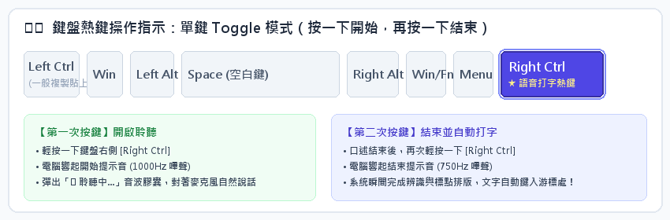
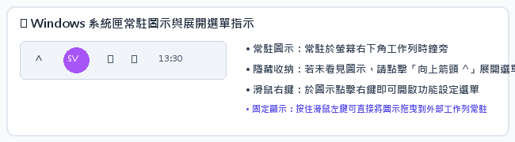
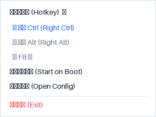

# FunASRVoiceTyper Turbo 雙引擎極速語音打字系統
## 使用者操作手冊 (User Operation Manual)

> **版本**：v2.0 Turbo (支援 SenseVoice-Small / Paraformer-large 雙模型即時熱切換・純本機極速推論)  
> **系統環境**：Windows 10 / Windows 11 (64-bit)  
> **常駐熱鍵**：預設鍵盤 `Right Ctrl`（開關切換式 Toggle Mode）

---

## 🌟 核心特色摘要

- **雙語音大模型自由切換**：整合阿里 2024 最新旗艦 **SenseVoice-Small**（超低延遲 <70ms、豐富標點、繁體台灣慣用語極致優化）與成熟穩健的 **Paraformer-large**（搭配 CT-Transformer 神經網絡斷句、長篇會議抗噪能力強）。
- **純本機離線極速推論**：100% 離線運作，本體僅約 35MB 輕量封裝，自帶神經網絡標點斷句與逆文本正規化 (ITN)，辨識延遲僅 50~100ms，**無須依賴且未內建任何肥大 LLM**，開箱即享極致打字體驗！
- **開關切換式操作 (Toggle Mode)**：按一下熱鍵叮一聲開始聆聽，說完再按一下咚一聲結束並自動上屏，**無須持續按住長按**，雙手完全自由！
- **開機自動常駐系統匣**：一鍵自動化安裝腳本，開機秒進背景常駐，100% 離線隱私保障，語音與文字絕不離開本機。

---

## 第一章 雙語音模型架構與規格解析

FunASRVoiceTyper_Turbo 採用阿里開源之頂尖非自回歸語音識別技術，提供兩大旗艦模型引擎，使用者可在系統匣選單中依使用情境即時切換：

| 比較項目 | SenseVoice-Small (預設推薦) | Paraformer-large (長句會議) |
| :--- | :--- | :--- |
| **模型發布年代** | 2024 年全新開源架構 | 成熟穩定非自回歸模型 |
| **推論延遲** | 極低延遲 (<70ms)，極速上屏 | 標準延遲 (<150ms) |
| **標點與數字正規化** | 內建豐富富文本標點、自動數字轉換 (ITN) | 搭配 CT-Transformer 神經網絡標點 |
| **繁體與中英夾雜** | 優異，完美支援台灣慣用語與科技中英混雜 | 穩健，適合大段標準普通話長句 |
| **推薦適用情境** | 日常即時對話、LINE/Slack 聊天、程式碼寫作、短句郵件 | 正式會議逐字稿、長篇訪談錄音、學術演講 |

---

## 第二章 快速安裝與開機自動常駐

本系統提供免安裝 Python 環境的綠色目錄封裝，解壓縮後即可一鍵自動化安裝。

### 2.1 一鍵自動安裝步驟
1. 進入解壓縮後的 `FunASRVoiceTyper_Turbo` 資料夾。
2. 對著「**Setup_安裝與開機啟動.bat**」按滑鼠右鍵選擇『以系統管理員身分執行』或直接按兩下滑鼠左鍵啟動。
3. 安裝精靈將自動執行以下動作：
   - 自動關閉舊版本程序，並將完整程式與 ONNX 模型部署至 Windows 使用者程式目錄：`%LOCALAPPDATA%\Programs\FunASRVoiceTyper_Turbo`。
   - 在 Windows 註冊表登錄開機常駐項目 (`HKCU\Software\Microsoft\Windows\CurrentVersion\Run`)，確保每次開機自動在背景運行。
   - 自動在桌面與開始功能表建立「**FunASRVoiceTyper Turbo**」快捷方式。
   - 自動在背景啟動程式，並在右下角工作列系統匣顯示常駐圖示。

### 2.2 完整解除安裝程序
若欲從電腦中完全移除本系統，只需在目錄中點擊「**Uninstall_解除安裝.bat**」即可。解除安裝精靈將安全關閉背景進程、移除開機註冊表項目、清理桌面與開始功能表捷徑，並完全刪除安裝目錄，不留下任何殘餘檔案。

---

## 第三章 語音打字核心操作規範 (開關式 Toggle Mode)

> [!WARNING]
> **操作方式特別說明（請務必注意）**：
> 本軟體採用【**開關切換式 (Toggle Mode)**】操作機制，絕對【**不是**】長按熱鍵不放！
> - **✔ 正確操作**：按一下熱鍵開始說話，說完再按一下熱鍵結束。手部在說話過程中完全自由，無須施力按壓鍵盤。
> - **✘ 錯誤操作**：按住熱鍵不放講話、說完才放開。這會造成按鍵重複觸發判定，導致錄音提早中斷。



### 3.1 四步驟標準打字流程

#### 【步驟一：啟動聆聽】
將文字輸入游標點在任何您想輸入文字的軟體上（例如：Word、LINE、Teams、瀏覽器、記事本等）。輕輕按一下鍵盤上的 **[右側 Ctrl]** 鍵（Right Ctrl）。此時耳機會聽見清脆的高頻「**叮（1000Hz）**」提示音，螢幕正下方將浮現紅色脈動麥克風聲波動畫。


#### 【步驟二：自然清晰說話】
以正常的語速與音量對麥克風說話。系統支援中英文混雜（例如：「*這份 API 的 Response 已經由 TSMC 工程師 Review 通過*」），且會自動為您添加標點符號與數字百分比（例如：「*產能利用率提高到 80%*」）。

#### 【步驟三：結束聆聽並開始辨識】
語音講完後，緊接著再按一下 **[右側 Ctrl]** 鍵。此時耳機會聽見沉穩的低頻「**咚（750Hz）**」提示音，浮動視窗立刻切換為深藍色流動進度光條，系統正以毫秒級速度執行非自回歸 ASR 特徵解碼、智能標點斷句與逆文本正規化。


#### 【步驟四：文字極速自動打上螢幕】
辨識完成後，浮動視窗轉為綠色打勾動畫並迅速淡出，轉換後的文字將如同真人打字般，自動、完整地填入您游標所在的視窗軟體中！


---

## 第四章 雙語音模型即時熱切換功能

FunASRVoiceTyper_Turbo 首創系統匣即時熱切換技術。無論您目前在進行何種工作，都能隨時切換最適合的語音引擎：

1. 移動滑鼠至螢幕右下角工作列系統匣，找到『**FT**』藍色圓形圖示。
2. 在圖示上點擊『**滑鼠右鍵**』，展開功能選單。
3. 移動至『**語音模型切換 (ASR Model)**』子選單：
   - 點選【**SenseVoice-Small (2024最新・高精準)**】：切換至阿里面向富文本多語音模型，響應極速，繁體台灣慣用詞轉換最為自然。
   - 點選【**Paraformer-large (經典穩健・會議轉錄)**】：切換至阿里成熟非自回歸大模型，搭配 CT-Transformer 神經網絡斷句，適合嘈雜環境與超長句子。
4. 點選後系統會發出雙音提示音確認切換，系統匣圖示浮動資訊與右鍵選單單選圓點立即同步更新，無須重新啟動軟體！

---

## 第五章 系統匣常駐圖示與右鍵選單功能全解




### 5.1 系統匣右鍵選單功能一覽
- **LLM 校正狀態指示（選配進階擴充）**：
  - 系統核心打字功能 100% 由本地語音模型（SenseVoice-Small / Paraformer-large）獨立極速運作，軟體預設【**無須且未內建**】額外的龐大 LLM 模型（如 Qwen2.5-3B）。
  - 系統匣選單預設顯示『**⚪ 離線 (本地標點+ITN模式)**』為標準正常狀態，文字轉錄、標點與繁體慣用字校正完全不受影響。
  - （選配）若進階使用者本機已自行安裝並常駐運行 Ollama (Qwen2.5-3B)，系統會自動偵測並切換至『🟢 在線』，提供額外的語意潤飾；若無則自動維持純語音模型的極速秒出字模式。
- **語音模型切換 (ASR Model)**：即時切換 SenseVoice-Small 或 Paraformer-large 雙模型。
- **快速鍵設定 (Hotkey)**：支援直接更換熱鍵為『右側 Ctrl (推薦)』、『右側 Alt』、『F8 鍵』或點擊『開啟設定檔手動自訂』。
- **開機自動啟動 (Start on Boot)**：點擊勾選即可開啟或關閉 Windows 開機隨系統啟動功能。
- **自訂專有名詞與設定 (Config)**：直接以記事本開啟 `config.json`。
- **結束程式 (Exit)**：完全退出軟體背景常駐。

---

## 第六章 個人化設定檔 (config.json) 說明

系統中的 `config.json` 允許使用者依個人喜好自訂熱鍵、預設語音引擎與**自訂專有名詞/別名替換**。
本軟體具備**「即時熱重載 (Hot Reload)」**功能：直接以記事本編輯存檔後，下次按下熱鍵立即套用，**無須重啟應用程式**！

```json
{
  "hotkey": "right ctrl",             // 全域開關熱鍵，推薦右側 Ctrl
  "asr_model_id": "Paraformer-large",  // 預設 ASR 模型 (SenseVoice-Small / Paraformer-large)
  "auto_start": true,                   // 開機是否自動啟動常駐
  "enable_correction": true,            // 進階選配：若本機有 Ollama 時是否啟用外部輔助校正
  "llm_timeout_seconds": 0.8,           // LLM 超時防護閾值 (秒)，超時自動降級回退
  "domain_terms": [                     // 產業專有名詞與同音字替換清單
    "台積電", "CoWoS", "EUV", "先進製程", "晶圓代工",
    "半導體", "AI", "API", "Meeting",
    "程式", "資安長", "資安",
    "城市=>程式",                      // 支援「錯字=>正字」顯式別名映射
    "治安=>資安"                       // 支援「同音錯字=>正確專有名詞」
  ]
}
```

### 【專有名詞功能特色】
1. **本機 100% 離線生效**：內建 `DomainTermsNormalizer` 聲學校正模組，不依賴任何外部或大型語言模型，毫秒級完成修正。
2. **同音字與模糊拼音自動校正**：納入台灣國語發音習慣（平捲舌音 `zh/z, ch/c, sh/s`、前後鼻音 `in/ing, en/eng`）。當您在 `domain_terms` 中加入「程式」或「資安」，系統辨識出同音的「城市」或「治安」時，會自動智慧替換為正確的專有名詞！
3. **顯式對照語法 (Alias Mapping)**：若特定詞彙發音差異較大或為自訂簡稱，可使用 `"錯字=>正字"`（例如 `"城市=>程式"`、`"扣窩斯=>CoWoS"`），系統會以最高優先權進行替換。
4. **英文大小寫自動正名**：輸入如 `"CoWoS"`、`"EUV"`、`"API"` 等專有名詞，系統會自動將語音轉出的 `cowos`、`api` 等自動正規化為正確的大小寫格式。

---

## 第七章 常見問題與排錯指南 (FAQ)

### Q1：按了熱鍵卻聽不到提示音，也沒有跳出浮動視窗？
- **原因一**：程式剛啟動時正在背景非同步加載語音模型權重（約需 1~3 秒）。加載完成時會有一聲短嗶聲，此後即可隨按隨用。
- **原因二**：系統匣圖示是否正常顯示『**FT**』？如果圖示為灰色『...』表示模型正在加載，若為紅色『ERR』請查看同目錄下的 `app.log` 日誌檔。
- **原因三**：以最高系統管理員權限運行的軟體（如特定的防毒軟體或工作管理員視窗），普通權限程式無法直接模擬打字，建議以管理員身分運行或將游標點在一般視窗中。

### Q2：SenseVoice-Small 與 Paraformer-large 我該如何選擇？
- **平時打字（聊天、發信、寫程式備註）**：強烈建議使用預設的【**SenseVoice-Small**】。延遲極低、語感自然、標點符號與台灣慣用字處理非常精準。
- **長篇會議或環境吵雜**：建議切換至【**Paraformer-large**】。模型參數量大，抗噪能力極佳，長句識別極為平穩。

### Q3：如果我不希望開機自動常駐，該如何關閉？
直接在右下角系統匣圖示上按滑鼠右鍵，在選單中點擊『**開機自動啟動 (Start on Boot)**』，取消勾選即可。
