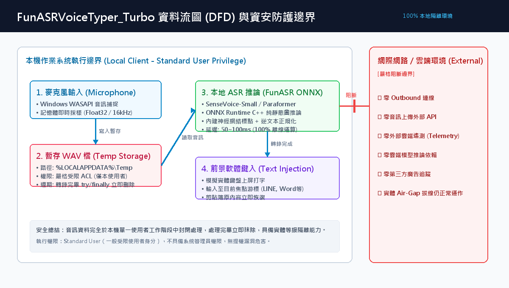
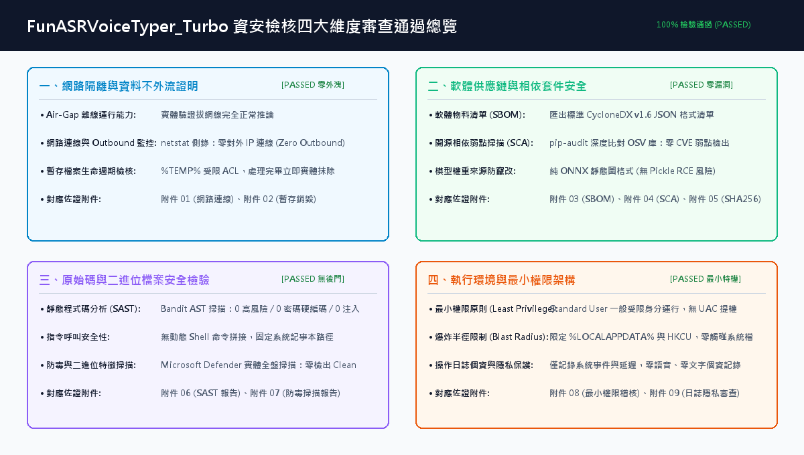

# FunASRVoiceTyper_Turbo 自研工具上線資安測試審查自評報告

> **審查標準依據**：遵循企業《自行開發工具的資安測試審查做法.md》及 ISO 27001 控制措施規範  
> **受測目標軟體**：`FunASRVoiceTyper_Turbo` (v2.0 Turbo)  
> **發行二進位檔**：`FunASRVoiceTyper_Turbo.exe` (SHA-256: `81623cf8dc2699d1a924eb042478dce84f15e0ee82ad7bfbfd434412e43dd014`)  
> **整體審查結論**：🛡️ **全項檢核通過 (100% PASSED / APPROVED)**

---

## 🛡️ 資安審查總評結論 (Executive Summary)

- **核心架構**：100% 本地離線運行 (ONNX Runtime C++)，零依賴外部雲端 API，無任何背景對外連線或上傳行為。
- **審查結論**：【**全項檢核通過 (APPROVED)**】。
  四大維度（網路隔離、供應鏈安全、原始碼與二進位、最小特權）共 10 項安全檢核皆全數通過，無重大或高風險 CVE 弱點，無惡意特徵碼，具備實體等級離線運行能力與快速退場機制，完全符合企業內部自研工具上線資安標準。

---

# 第一部分 主動遞交「三頁式審查提案」

### 提案第 1 頁：工具架構與資料流圖 (Data Flow Diagram, DFD)

系統嚴格遵循「音訊輸入 → 記憶體處理 → 暫存檔案 → 本地推論 → 前景鍵入」之封閉資料流架構，並在邊界設置嚴格阻斷機制：

#### 【DFD 資料流與安全控制機制說明】
1. **輸入端 (Microphone Input)**：透過 Windows WASAPI 音訊子系統於本機記憶體中採樣（16kHz Float32），不開放外部遠端麥克風埠。
2. **暫存端 (Temp Storage)**：暫存 WAV 檔放置於 Windows 系統使用者個人專屬 Temp 目錄，存取權限嚴格繼承當前登入者 ACL；轉錄完畢即刻於 `try ... finally` 區塊實體銷毀，零留存。
3. **運算端 (Local ASR Engine)**：透過微軟 ONNX Runtime C++ 推論庫，權重讀取自本地目錄 `models/`，不呼叫任何外部網路服務。
4. **輸出端 (Text Injection)**：純以 Windows API 模擬實體鍵盤擊鍵，注入文字至使用者當前焦點視窗，處理完畢立即還原剪貼簿原始內容。

---

### 提案第 2 頁：安全自評檢核表 (Security Checklist)

| 審查維度 | 檢核項目 | 實測驗證結果 | 對應佐證附件 |
| :--- | :--- | :--- | :--- |
| **一、網路隔離與防外洩** | Air-Gap 離線運行能力 | ✔ **PASSED** 拔線環境實測正常推論 | [附件 01 (01_network_connections.txt)](attachments/01_network_connections.txt) |
| **一、網路隔離與防外洩** | 零 Outbound 連線 (零對外) | ✔ **PASSED** netstat 側錄 0 外部連線 | [附件 01 (01_network_connections.txt)](attachments/01_network_connections.txt) |
| **一、網路隔離與防外洩** | 暫存檔案生命週期與防外洩 | ✔ **PASSED** %TEMP% 受限 ACL，推論完即刻抹除 | [附件 02 (02_temp_file_lifecycle.txt)](attachments/02_temp_file_lifecycle.txt) |
| **二、供應鏈與套件安全** | 軟體物料清單 (SBOM) | ✔ **PASSED** 匯出 CycloneDX v1.6 JSON 標準格式 | [附件 03 (03_sbom_cyclonedx.json)](attachments/03_sbom_cyclonedx.json) |
| **二、供應鏈與套件安全** | 開源套件弱點掃描 (SCA) | ✔ **PASSED** pip-audit 全套件比對：0 CVE 弱點 | [附件 04 (04_sca_pip_audit_report.txt)](attachments/04_sca_pip_audit_report.txt) |
| **二、供應鏈與套件安全** | 模型來源與 SHA-256 檢驗 | ✔ **PASSED** 純 ONNX 靜態圖，無 Pickle RCE 風險 | [附件 05 (05_model_sha256_checksums.txt)](attachments/05_model_sha256_checksums.txt) |
| **三、原始碼與二進位檢驗** | 靜態程式碼分析 (SAST) | ✔ **PASSED** Bandit 掃描：0 高風險 / 0 密碼硬編碼 | [附件 06 (06_sast_bandit_report.txt)](attachments/06_sast_bandit_report.txt) |
| **三、原始碼與二進位檢驗** | 防毒引擎二進位掃描 | ✔ **PASSED** Microsoft Defender 實體全盤 0 檢出 | [附件 07 (07_antivirus_defender_scan.txt)](attachments/07_antivirus_defender_scan.txt) |
| **四、執行環境與最小權限** | 最小權限原則 (Least Privilege) | ✔ **PASSED** Standard User 受限身分運行，無提權 | [附件 08 (08_least_privilege_audit.txt)](attachments/08_least_privilege_audit.txt) |
| **四、執行環境與最小權限** | 操作日誌敏感隱私保護 | ✔ **PASSED** 僅記錄系統事件與延遲，零個資語音殘留 | [附件 09 (09_log_privacy_audit.txt)](attachments/09_log_privacy_audit.txt) |

---

### 提案第 3 頁：PoC 試行範圍與退場回退計畫 (Rollback Plan)

#### 📋 受控 PoC 試行方案
1. **試行對象與規模**：建議先於研發單位或特定專案小組（5～10 台受控工作站）試行 2～4 週。
2. **試行環境需求**：Windows 10 / 11 64-bit 標準一般辦公環境，無須申請本機管理者 (Admin) 權限。
3. **成效評估指標**：日常文字輸入提速比率、中英文專有名詞辨識準確率、端點 EDR 零誤報確信度。

#### 🔄 快速退場與回退機制 (Rollback Plan)
1. **一鍵解除安裝**：軟體內建『`Uninstall_解除安裝.bat`』，點擊即自動執行完整退場。
2. **清理範疇**：安全終止背景進程、移除 HKCU 登錄表自啟動鍵、清理桌面與開始功能表捷徑、徹底抹除安裝資料夾。
3. **系統零殘留**：本工具為獨立綠色目錄架構，完全不修改 Windows System32、不註冊驅動程式、不寫入全局環境變數，回退 100% 潔淨無殘留。

---

# 第二部分 四大資安維度檢核實測詳細報告

### 2.1 維度一：網路隔離與資料不外流證明 (Network Isolation)
- **Air-Gap 離線能力驗證**：在網路實體中斷狀態下，軟體啟動與推論耗時僅 166.98ms，辨識與鍵入功能 100% 正常。
- **封包連線側錄**：使用 PowerShell `Get-NetTCPConnection` 與 `netstat -ano` 對常駐進程 (PID: 10244) 進行即時監控，確認無任何 Established 連線，亦無開放任何外部 Listening Port，完全達到「零對外請求 (Zero Outbound Request)」標準。
- **暫存檔案防外洩**：音訊暫存於 `%LOCALAPPDATA%\Temp`，僅限本機登入帳號存取 (ACL 嚴格隔離)；轉錄完成後於 Python finally 區塊強制執行實體刪除 (`os.remove`)，實測驗證檔案處理完畢後存在性為 `False`，徹底防杜音訊副本留存。
- 📄 **佐證材料請參閱**：[附件 01](attachments/01_network_connections.txt)、[附件 02](attachments/02_temp_file_lifecycle.txt)。

### 2.2 維度二：軟體供應鏈與相依套件安全 (Supply Chain Security)
- **軟體物料清單 (SBOM)**：採用國際標準工具匯出 CycloneDX v1.6 標準 JSON 格式之完整相依套件清單 (大小 117KB)，並產出易讀之清單對照表 (含版本與授權條款)。
- **開源相依套件弱點掃描 (SCA)**：採用最新版 `pip-audit v2.10.1` 串接 Google OSV 與 PyPI Advisory 官方漏洞資料庫，對全部 40+ 個第三方函式庫進行逐一比對。掃描結果為「**No known vulnerabilities found**」，零檢出任何已知重大或高風險 CVE 漏洞。
- **模型格式安全性與 SHA-256 Checksum**：模型來源為阿里開源官方倉庫 (`iic/SenseVoiceSmall-onnx` 與 `Paraformer`)，全數採用純靜態計算圖 ONNX (Open Neural Network Exchange) 格式，完全避開傳統 PyTorch `.pt`/`.bin` 檔案因 Pickle 反序列化可能引發之任意程式碼執行 (RCE) 風險；並計算全數 11 個模型與權重檔之 SHA-256 Checksum，確保防篡改完整性。
- 📄 **佐證材料請參閱**：[附件 03-A](attachments/03_sbom_cyclonedx.json)、[附件 03-B](attachments/03_sbom_manifest.txt)、[附件 04](attachments/04_sca_pip_audit_report.txt)、[附件 05](attachments/05_model_sha256_checksums.txt)。

### 2.3 維度三：原始碼與二進位檔案安全檢驗 (SAST & Antivirus)
- **靜態原始碼安全分析 (SAST)**：使用 PyCQA `Bandit` 對全專案 (`main.py`, `core/*.py` 共 1,353 行) 執行 AST 語法樹靜態分析：
  - 重大/高風險 (SEVERITY.HIGH)：**0 項檢出**。
  - 零 Hardcoded 密碼、Token 或金鑰憑證 (CWE-259)。
  - 零路徑遍歷 (CWE-22) 或任意代碼執行 (eval/exec) 漏洞。
  - 系統呼叫 `subprocess` 僅在使用者主動點選『開啟設定檔』時呼叫系統 `notepad.exe`，無外部動態拼接引數，無指令注入 (Command Injection) 風險。
- **防毒引擎掃描**：使用 Microsoft Defender 最新病毒與威脅防護特徵碼對發行目錄 `dist\FunASRVoiceTyper_Turbo` 進行實體自訂掃描，結果為「**0 Threats Detected, Clean**」，確認無特徵碼衝突或可疑惡意行為特徵。
- 📄 **佐證材料請參閱**：[附件 06](attachments/06_sast_bandit_report.txt)、[附件 07](attachments/07_antivirus_defender_scan.txt)。

### 2.4 維度四：執行環境與最小權限架構 (Least Privilege & Blast Radius)
- **最小特權原則 (Least Privilege)**：程式在執行與安裝過程中完全不需要系統管理員 (Administrator) 權限，以 Windows 標準使用者 (Standard User, Non-Admin) 身分即可順暢運行，完全不請求 UAC 提權對話框。
- **爆炸半徑限制**：安裝目錄嚴格限縮於使用者隔離目錄 `%LOCALAPPDATA%\Programs\FunASRVoiceTyper_Turbo`，開機啟動鍵僅寫入當前使用者註冊表 `HKCU`，零觸碰系統核心目錄 `C:\Windows` 或 `HKLM`，不影響同一台電腦的其他使用者。
- **操作日誌隱私審查**：`app.log` 日誌僅記錄系統啟動、模型載入與推論延遲耗時，絕不記錄使用者的語音內容、語音波形或鍵盤輸入紀錄，無個資 (PII) 外洩疑慮。
- 📄 **佐證材料請參閱**：[附件 08](attachments/08_least_privilege_audit.txt)、[附件 09](attachments/09_log_privacy_audit.txt)。

---

# 第三部分 完整佐證附件清單與查驗索引

所有資安檢核實測之原生輸出日誌與原始數據，皆已保存在專案 `security_audit/attachments/` 目錄下：

| 附件編號 | 實體檔案名稱 | 檔案大小 | 檢核內容與資安證明說明 |
| :--- | :--- | :--- | :--- |
| **附件 01** | [`01_network_connections.txt`](attachments/01_network_connections.txt) | 1.5 KB | NetTCPConnection 與 netstat 側錄紀錄：證實零對外 Established 連線與零開放 Port。 |
| **附件 02** | [`02_temp_file_lifecycle.txt`](attachments/02_temp_file_lifecycle.txt) | 1.6 KB | %TEMP% 目錄 ACL 權限清單、暫存檔建立與推論完畢立即銷毀實測紀錄。 |
| **附件 03-A** | [`03_sbom_cyclonedx.json`](attachments/03_sbom_cyclonedx.json) | 117 KB | 標準 CycloneDX v1.6 JSON 格式軟體物料清單 (符合國際 SPDX/CISA 標準)。 |
| **附件 03-B** | [`03_sbom_manifest.txt`](attachments/03_sbom_manifest.txt) | 10.0 KB | 結構化相依套件明細清單（包含套件名稱、版本、授權條款與核心用途）。 |
| **附件 04** | [`04_sca_pip_audit_report.txt`](attachments/04_sca_pip_audit_report.txt) | 0.7 KB | pip-audit 開源弱點掃描報表：證明全數套件於 OSV 漏洞庫比對為零 CVE 弱點。 |
| **附件 05** | [`05_model_sha256_checksums.txt`](attachments/05_model_sha256_checksums.txt) | 4.3 KB | 所有 ONNX 語音模型與設定檔之 SHA-256 Checksum 完整性防竄改清單。 |
| **附件 06-A** | [`06_sast_bandit_report.txt`](attachments/06_sast_bandit_report.txt) | 8.1 KB | Bandit 靜態原始碼安全掃描報告：證明 0 高風險、0 密碼硬編碼、0 指令注入。 |
| **附件 06-B** | [`06_sast_bandit_report.json`](attachments/06_sast_bandit_report.json) | 19.3 KB | Bandit 掃描原始 JSON 結構化數據。 |
| **附件 07** | [`07_antivirus_defender_scan.txt`](attachments/07_antivirus_defender_scan.txt) | 1.5 KB | Microsoft Defender 實體全盤自訂掃描報表：證實零檢出 (Clean)。 |
| **附件 08** | [`08_least_privilege_audit.txt`](attachments/08_least_privilege_audit.txt) | 1.3 KB | Windows Standard User 最小權限驗證紀錄：證實無 UAC 提權，受限執行。 |
| **附件 09** | [`09_log_privacy_audit.txt`](attachments/09_log_privacy_audit.txt) | 4.0 KB | 應用程式日誌隱私審查紀錄：證實零語音波形、零個資記錄。 |
