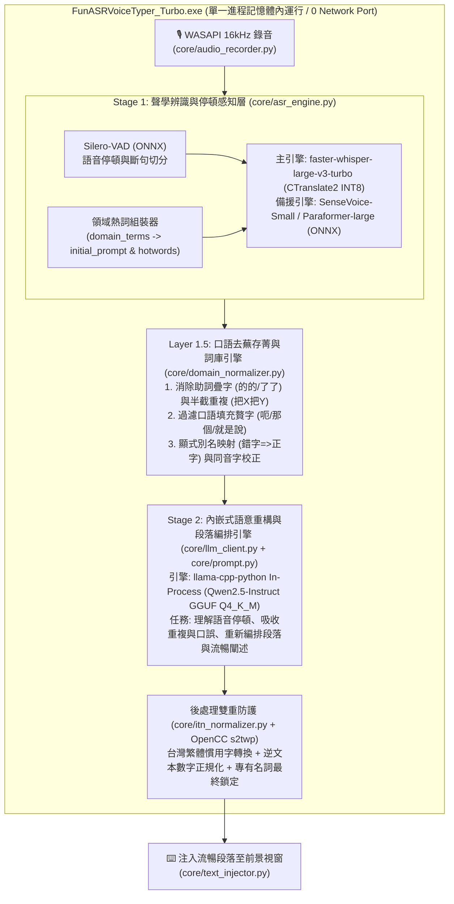

# 📘 FunASRVoiceTyper_Turbo v3.0 全內嵌雙引擎升級 — 主執行工作說明書 (Master Execution Specification)

> **專案根目錄**：`C:\Users\Chery\.gemini\antigravity\scratch\FunASRVoiceTyper_Turbo`
> **Python 虛擬環境**：`C:\Users\Chery\.gemini\antigravity\scratch\FunASRVoiceTyper_Turbo\.venv\Scripts\python.exe` (Python 3.12.14 x64)
> **目標執行模型**：Gemini 3.8 Flash
> **文件版本**：v3.0-Enterprise-InProcess

---

## 一、 專案背景與核心痛點診斷 (Problem Statement)

使用者長期使用本語音打字系統後，提出以下兩大核心痛點與企業部署限制，本升級計畫必須 **100% 徹底解決**：

### 1. 痛點一：第一階段語音辨識（ASR）錯誤率過高
- **現況根因**：
  - 目前預設使用 `Paraformer-large` / `SenseVoice-Small`（非自回歸 NAR 模型）。雖然推論速度快，但缺乏自回歸前後文語意推理能力，對台灣繁體中文職場常見的**中英夾雜（Code-Switching）**與**技術專有名詞**（例如：`Google Antigravity`、`Claude Code`、`Ubuntu`、`SFTPGo`、`GitHub`）常發生嚴重聽寫錯誤（在 `app.log` 中曾被誤聽為 `reno 4`、`integravity`、`cloucoo`）。
  - 既有 `core/asr_engine.py` 的 `transcribe()` 雖然接收了 `domain_terms` 參數，但**在聲學解碼階段完全未使用**，僅依賴事後的中文同音字替換，對英文與跨字詞誤聽毫無作用。
- **解決方案**：
  - 導入內嵌式 **`faster-whisper`（基於 CTranslate2 C++ 引擎，免裝 PyTorch）**，搭載 **`faster-whisper-large-v3-turbo` (INT8 量化)** 模型。
  - 在 `transcribe()` 聲學解碼時，動態將 `domain_terms` 轉換為 Whisper 的 **`initial_prompt` 與 `hotwords`（聲學上下文熱詞導引）**，讓模型在「聽音訊」的當下直接鎖定正確的中英文專有名詞。
  - 啟用內建 `Silero-VAD`（ONNX）語音活動偵測，精準感知說話者的**自然停頓與換氣節奏**，避免將停頓前後不相關的字詞硬湊成錯字。
  - 保留原有的 `SenseVoice-Small` 與 `Paraformer-large` 作為系統匣可隨時熱切換的輕量備援引擎。

### 2. 痛點二：缺乏整段語意理解、不會針對停頓/贅字/重複語句自動修訂與重新編排闡述
- **現況根因**：
  - 既有架構依賴外部 `http://localhost:11434/v1` (Ollama) 進行第二階段（Stage 2 LLM）修訂，但本機與公司電腦**並未安裝 Ollama**，導致每次錄音皆在 `0.0ms` 觸發降級備援（`is_fallback=True`），Stage 2 的去贅字與段落重編功能從未實際生效。
  - 既有 `config.json` 將 `llm_timeout_seconds` 設為 `1.5` 秒、`typeless_timeout_seconds` 設為 `4.0` 秒，當使用者口述 30～70 秒的長段落時，本地模型來不及生成完畢即被強制切斷。
  - 既有 `core/domain_normalizer.py` 的 `_remove_stutters()` 規則過於陽春，無法處理 ASR 常見的助詞疊字（如 `實驗類的的指令碼`）或半截重複片語（如 `把連結把公佈出來的連線網址`）。
  - 既有 `core/prompt.py` 的提示詞偏重「逐句改錯字」，缺乏對**「說話停頓、語意贅字、前後重複或補充語句的吸收融合，以及整段內容重新編排、修訂與流暢闡述」**的深層指導。
- **解決方案**：
  - 導入 **`llama-cpp-python`（純 C++ GGUF 記憶體內推論引擎）**，直接於主進程記憶體內載入 **`Qwen2.5-1.5B-Instruct-Q4_K_M.gguf`**（或 `Qwen2.5-3B-Instruct-Q4_K_M.gguf`），徹底擺脫對外部 Ollama 的依賴。
  - 擴充 `core/domain_normalizer.py` 的口語去蕪存菁規則（消除疊字、口頭禪、半截重複）。
  - 重新設計 `core/prompt.py` 的三種打字模式提示詞：
    1. **`instant`（極速精準模式）**：修正同音錯字、補齊自然標點、去除明顯口吃。
    2. **`typeless`（流暢修訂與段落重編模式 — 預設推薦）**：深度理解整段話的語意，自動消除語音停頓產生的斷裂感、剔除語意贅字、將前後重複或自我修正的語句**融合重組為通順流暢的書面闡述**，並依邏輯自動分段或條列。
    3. **`structured`（結構化筆記／指令闡述模式）**：專為長篇口述需求或 AI 提示詞（Prompt）設計，將發散的口述內容重構為「核心目標 + 結構化條列重點／步驟 + 預期產出」的專業格式。

---

## 二、 企業部署與資安合規紅線 (Enterprise Security Constraints)

本軟體最終需打包部署至**企業內部辦公電腦（Standard User 標準受限帳號，不允許安裝 Ollama）**，並通過專案內建之 7 大資安檢測腳本（`audit_step1_network.py` ～ `audit_step7_least_privilege.py`）。執行修改時**嚴格遵守以下紅線**：

1. **禁止依賴外部服務、禁止開啟任何網路 Listening Port**：
   - 本地 LLM 必須優先使用 `llama-cpp-python` 的 **In-Process 記憶體直連模式**（直接呼叫 Python/C++ 物件 `Llama(model_path=...)`），**絕對不可在背景啟動 HTTP Server 或開啟任何 TCP Listening Port**，確保 `audit_step1_network.py` 的 `Get-NetTCPConnection` 與 `netstat -ano` 檢測維持 **0 連線、0 Port**。
   - 若設定為內嵌模式（`llm_backend: "embedded"`），禁止發起任何 `urllib` socket 探測。
2. **禁止引入 PyTorch (`torch`)**：
   - 所有新增模型僅限使用純靜態安全格式：**CTranslate2 (`.bin`)**、**ONNX (`.onnx`)** 與 **GGUF (`.gguf`)**，完全杜絕 PyTorch Pickle 反序列化 RCE 風險，並維持 PyInstaller 打包輕量化。
3. **硬體相容性（支援無獨顯之公司電腦與 2GB VRAM 筆電）**：
   - 開發機配備 `Intel Core i5-1135G7 (4C/8T) + 16GB RAM + NVIDIA MX450 (2GB VRAM)`，而公司電腦可能僅有 Intel CPU + 16GB RAM。
   - 因此 `faster-whisper` 與 `llama-cpp-python` 必須預設支援 **CPU AVX2 多執行緒高速推論（INT8 / Q4_K_M 量化）**，並具備自動偵測硬體降級保護，絕不可因缺少 CUDA DLL 或顯存不足而崩潰。
4. **SAST 靜態掃描合規（Bandit 0 High Severity）**：
   - 程式碼中不得使用 `eval`、`exec`、`shell=True`，不得硬編碼任何機密金鑰。

---

## 三、 整體升級架構圖 (Target Architecture)



---

## 四、 執行階段總覽與 Phase 1 環境建置步驟

請執行模型（Gemini 3.8 Flash）依序執行以下三個階段：

- **Phase 1：安裝 C++ 推論套件與下載本地模型權重**（見本文件下方步驟 1.1 ～ 1.2）
- **Phase 2：核心程式碼改寫與升級**（請詳閱 [`02_CODE_MODIFICATION_GUIDE_程式碼完整改寫規格書.md`](./02_CODE_MODIFICATION_GUIDE_程式碼完整改寫規格書.md)）
- **Phase 3：自動化測試驗收、打包配置與資安審查更新**（請詳閱 [`03_PACKAGING_AND_SECURITY_AUDIT_打包與資安檢驗規範.md`](./03_PACKAGING_AND_SECURITY_AUDIT_打包與資安檢驗規範.md)）

---

### 🔧 Phase 1 - 步驟 1.1：在專案 `.venv` 安裝預編譯二進位套件

> **重要提醒**：Windows 環境下安裝 `llama-cpp-python` 時，請務必加上 `--only-binary=:all:` 與官方預編譯 Wheel 索引（或安裝預編譯 CPU wheel），避免觸發本機 CMake / MSVC 編譯失敗。

請在 PowerShell 執行以下指令（使用專案 `.venv`）：

```powershell
# 1. 安裝 faster-whisper 與 huggingface-hub (均為預編譯 Wheel，不依賴 torch)
& "C:\Users\Chery\.gemini\antigravity\scratch\FunASRVoiceTyper_Turbo\.venv\Scripts\python.exe" -m pip install faster-whisper huggingface-hub

# 2. 安裝預編譯版 llama-cpp-python (CPU AVX2 通用版，確保開發機與公司電腦 100% 相容免編譯)
& "C:\Users\Chery\.gemini\antigravity\scratch\FunASRVoiceTyper_Turbo\.venv\Scripts\python.exe" -m pip install llama-cpp-python --prefer-binary --extra-index-url https://abetlen.github.io/llama-cpp-python/whl/cpu
```

*(註：若上述 `abetlen` 索引在特定版本沒有對應 cp312 wheel，可改用：`pip install llama-cpp-python==0.3.16 --prefer-binary --extra-index-url https://abetlen.github.io/llama-cpp-python/whl/cpu` 或從 GitHub Releases 下載對應 `cp312-cp312-win_amd64.whl` 安裝，詳見下方下載腳本內建的自動檢查邏輯。)*

---

### 🔧 Phase 1 - 步驟 1.2：建立並執行模型權重下載腳本 `download_upgrade_models.py`

我們需要將兩個核心離線模型下載至專案 `models/` 目錄下，以便日後離線運行與打包：
1. **Stage 1 ASR 模型**：`models/faster-whisper-turbo`（來源：`deepdml/faster-whisper-large-v3-turbo-ct2`，CTranslate2 格式，約 800MB，支援 INT8 高速推論）。
2. **Stage 2 內嵌 LLM 模型**：`models/llm/qwen2.5-1.5b-instruct-q4_k_m.gguf`（來源：`Qwen/Qwen2.5-1.5B-Instruct-GGUF`，約 986MB，CPU 推論極快，1～2 秒完成整段重構）與可選的 `qwen2.5-3b-instruct-q4_k_m.gguf`（來源：`Qwen/Qwen2.5-3B-Instruct-GGUF`）。預設下載 **1.5B**（兼顧公司純 CPU 電腦極速反應與優秀的繁中段落重組能力），若磁碟與記憶體充裕亦可透過參數 `--3b` 下載 3B 版本。

請在專案根目錄 `C:\Users\Chery\.gemini\antigravity\scratch\FunASRVoiceTyper_Turbo\download_upgrade_models.py` 建立以下腳本並執行它：

```python
# coding: utf-8
"""
download_upgrade_models.py
自動下載 FunASRVoiceTyper_Turbo v3.0 所需之本地離線模型權重：
1. Stage 1 ASR: deepdml/faster-whisper-large-v3-turbo-ct2 -> models/faster-whisper-turbo
2. Stage 2 LLM: Qwen/Qwen2.5-1.5B-Instruct-GGUF (或 3B) -> models/llm/
"""

import os
import sys
from huggingface_hub import snapshot_download, hf_hub_download

BASE_DIR = os.path.dirname(os.path.abspath(__file__))
MODELS_DIR = os.path.join(BASE_DIR, "models")
WHISPER_DIR = os.path.join(MODELS_DIR, "faster-whisper-turbo")
LLM_DIR = os.path.join(MODELS_DIR, "llm")


def download_all(use_3b: bool = False):
    os.makedirs(WHISPER_DIR, exist_ok=True)
    os.makedirs(LLM_DIR, exist_ok=True)

    print("=" * 65)
    print(" [1/2] 正在下載 Stage 1 ASR 模型: faster-whisper-large-v3-turbo (CT2)")
    print("=" * 65)
    snapshot_download(
        repo_id="deepdml/faster-whisper-large-v3-turbo-ct2",
        local_dir=WHISPER_DIR,
        local_dir_use_symlinks=False,
        ignore_patterns=["*.md", ".gitattributes"]
    )
    print(f"✓ Whisper Turbo 模型已就緒: {WHISPER_DIR}\n")

    print("=" * 65)
    if use_3b:
        repo_id = "Qwen/Qwen2.5-3B-Instruct-GGUF"
        filename = "qwen2.5-3b-instruct-q4_k_m.gguf"
    else:
        repo_id = "Qwen/Qwen2.5-1.5B-Instruct-GGUF"
        filename = "qwen2.5-1.5b-instruct-q4_k_m.gguf"

    print(f" [2/2] 正在下載 Stage 2 內嵌 LLM 模型: {repo_id} ({filename})")
    print("=" * 65)
    gguf_path = hf_hub_download(
        repo_id=repo_id,
        filename=filename,
        local_dir=LLM_DIR,
        local_dir_use_symlinks=False
    )
    print(f"✓ 內嵌 GGUF 語言模型已就緒: {gguf_path}\n")
    print("🎉 所有 v3.0 離線模型下載完成！")


if __name__ == "__main__":
    use_3b_flag = "--3b" in sys.argv
    download_all(use_3b=use_3b_flag)
```

完成 Phase 1 後，請立即進入 [`02_CODE_MODIFICATION_GUIDE_程式碼完整改寫規格書.md`](./02_CODE_MODIFICATION_GUIDE_程式碼完整改寫規格書.md) 進行程式碼升級。
