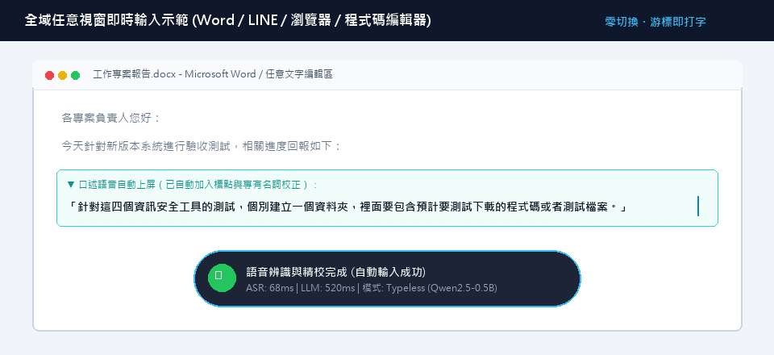
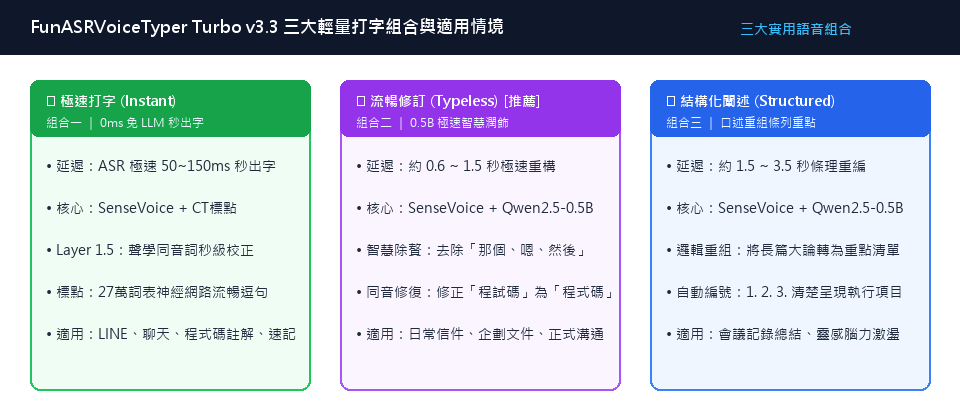
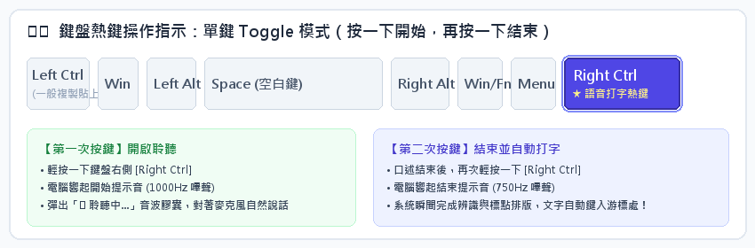
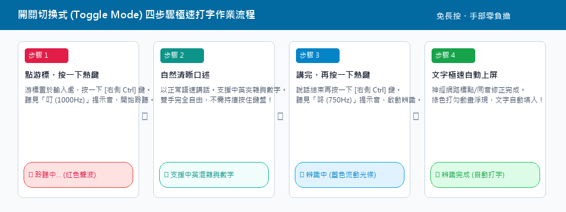
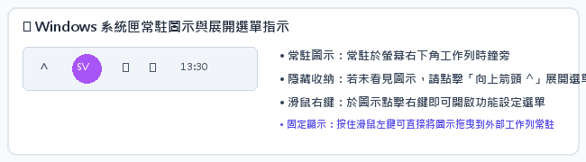
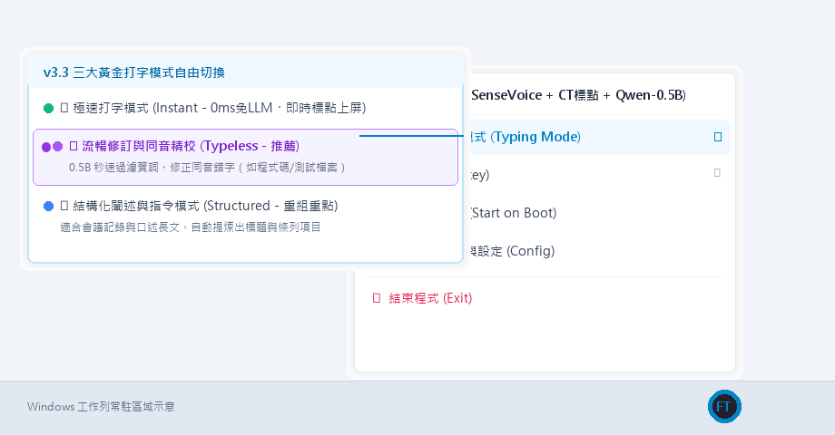
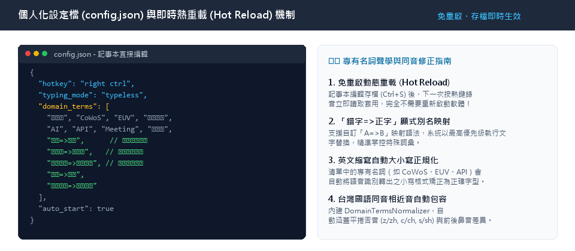

# FunASRVoiceTyper Turbo v3.3 (黃金輕量專用版)
## 使用者操作手冊 (User Operation Manual)

> **版本**：v3.3 Lean Golden Edition (SenseVoice-Small + CT-Transformer + Qwen2.5-0.5B)  
> **系統環境**：Windows 10 / Windows 11 (64-bit)  
> **預設熱鍵**：鍵盤 `Right Ctrl`（開關切換式 Toggle Mode）  
> **推論模式**：100% 本地離線推論（零網路依賴・實體隔離拔線可用）

---

## 🌟 核心特色摘要

- **極致輕量化純本機架構**：本版本已全面剔除所有不需要的繁雜與肥大模型，專案結構大幅瘦身，純粹聚焦於本機極速打字核心。固定採用一套 **SenseVoice-Small** (ONNX 語音大模型) 與 27 萬詞表 **CT-Transformer** 獨立標點神經網絡，搭配內嵌超輕量 **Qwen2.5-0.5B-Instruct** (GGUF)，達到極速秒出字與極致資源精簡。
- **僅保留三大實用打字模式組合**：
  - **🟢 極速打字模式 (Instant - 0ms 免 LLM)**：ASR 50~150ms 秒出字，適合 LINE/Slack 即時通訊與日常短句。
  - **🟣 流暢修訂與同音精校 (Typeless - 0.5B 潤飾・推薦)**：0.6~1.5 秒秒速過濾口語贅詞（那個、嗯、然後）並修復同音錯字（如程式碼、測試檔案），產出最專業書面語句。
  - **🔵 結構化闡述與指令模式 (Structured - 重組重點)**：將口述長文自動提煉為結構化條列標題與編號清單，適合會議記錄與訪談筆記。
- **開關切換式操作 (Toggle Mode)**：按一下熱鍵叮一聲開始聆聽，說完再按一下咚一聲結束並自動上屏，**無須持續按住鍵盤**，雙手完全自由！
- **專有名詞聲學智慧修正**：內建 Layer 1.5 專有名詞聲學校正模組，支援「`錯字=>正字`」別名強制映射、科技英文大小寫自動正規化，並自動包容台灣國語平捲舌與前後鼻音差異。
- **一鍵自動安裝與開機常駐**：解壓縮後雙擊 `Setup_安裝與開機啟動.bat` 即可全自動部署至 Windows 使用者目錄並登錄開機常駐，開箱即用。

---



---

## 第一章 系統架構與三大打字模式組合深度解析

FunASRVoiceTyper Turbo 最新修訂版為極致輕量化專用設計，已將所有不需要的多餘模型全數移除，專案結構大幅瘦身，目前全系統僅精準收斂為「三大實用打字組合」。使用者無須再手動設定或挑選底層複雜的模型引擎，開箱即可透過工作列系統匣選單，隨時依當前的工作與對話情境一鍵切換最適組合：



### 1.1 三大打字模式特色與適用情境

| 打字模式組合 | 核心架構機制 | 平均上屏延遲 | 最佳適用情境 |
| :--- | :--- | :---: | :--- |
| **組合一：<br>🟢 Instant 極速打字** | SenseVoice + CT標點 + 聲學專有名詞秒級校正 (0ms 免 LLM) | **50 ~ 150 ms**<br>(極速秒出字) | LINE / Slack 聊天、社群對話、程式碼註解、快速記事 |
| **組合二：<br>🟣 Typeless 流暢修訂<br>(預設推薦)** | SenseVoice + CT標點 + Qwen2.5-0.5B 輕量重構，去除口語贅字並修復同音錯字 | **0.6 ~ 1.5 秒**<br>(流暢自然) | 商務 Email、專案企劃、行政公文撰寫、團隊溝通 |
| **組合三：<br>🔵 Structured 結構化** | SenseVoice + Qwen2.5-0.5B 結構化 Prompt，自動提煉出標題與條列編號 | **1.5 ~ 3.5 秒**<br>(條理分明) | 會議記錄總結、待辦清單整理、訪談重點梳理 |

---

## 第二章 快速安裝與開機自動常駐

### 2.1 一鍵自動安裝步驟
1. 進入解壓縮後的 `FunASRVoiceTyper_Turbo` 資料夾。
2. 雙擊執行「**Setup_安裝與開機啟動.bat**」。
3. 安裝精靈將自動在背景完成：
   - 部署完整程式與神經網絡權重至 `%LOCALAPPDATA%\Programs\FunASRVoiceTyper_Turbo`。
   - 寫入 Windows 註冊表開機啟動項目 (`HKCU\Software\Microsoft\Windows\CurrentVersion\Run`)。
   - 於桌面與 Windows「開始」功能表建立「**FunASRVoiceTyper Turbo**」快捷方式。
   - 自動在背景常駐啟動，並在右下角系統匣顯示常駐圖示。

### 2.2 完整解除安裝程序
直接點擊目錄中的「**Uninstall_解除安裝.bat**」，精靈將自動關閉背景進程、清理註冊表、移除捷徑並完全刪除安裝目錄，不留下任何殘餘檔案。

---

## 第三章 語音打字核心操作規範 (開關式 Toggle Mode)

> [!WARNING]
> **操作方式特別說明（請務必注意）**：
> 本軟體採用【**開關切換式 (Toggle Mode)**】操作機制，絕對【**不是**】長按熱鍵不放！
> - **✔ 正確操作**：按一下熱鍵開始說話，說完再按一下熱鍵結束。說話過程中手部完全自由，無須施力按壓鍵盤。
> - **✘ 錯誤操作**：按住熱鍵不放講話、說完才放開。這會造成按鍵重複觸發判定，導致錄音提早中斷。



### 3.1 四步驟標準打字流程



#### 【步驟一：定位游標並啟動聆聽】
將文字輸入游標點在任何軟體中（如 Word、LINE、Teams、瀏覽器、記事本、VS Code）。輕輕按一下鍵盤上的 **[右側 Ctrl]** 鍵。耳機將聽見清脆的高頻「**叮（1000Hz）**」提示音，螢幕正下方浮現紅色脈動麥克風波形膠囊。


#### 【步驟二：以正常語速自然說話】
對麥克風自然口述即可。系統全面支援：
- **中英文夾雜混說**：例如「*這份 API 的 Response 已經由 TSMC 工程師 Review 通過*」。
- **數字、年份與百分比自動轉換 (ITN)**：例如口述「*產能提升百分之八十*」，自動轉換為「*產能提升 80%*」。
- **自動標點斷句**：27 萬詞表神經網絡自動輸出全形逗號與句號。

#### 【步驟三：結束說話並啟動辨識】
說話結束後，再次輕按一下 **[右側 Ctrl]** 鍵。耳機聽見沉穩的低頻「**咚（750Hz）**」提示音，浮動視窗切換為藍色流動進度光條，系統以毫秒級速度執行 ASR 特徵解碼與同音修正。


#### 【步驟四：文字極速自動打上螢幕】
辨識完成瞬間，浮動視窗轉為綠色打勾動畫並迅速淡出，轉換後的文字如同真人打字般，自動完整填入游標所在的軟體中！


---

## 第四章 系統匣常駐圖示與右鍵功能選單全解




### 4.1 系統匣圖示狀態說明
- 🔵 **藍色「FT」**：正常待命狀態，隨時可按熱鍵打字。
- ⚪ **灰色「...」**：背景模型載入預熱中（約 1~2 秒），請稍候。
- 🔴 **紅色「REC」**：錄音中，麥克風開啟。
- 🔴 **紅色「ERR」**：模型載入異常，請查看同目錄下之 `app.log`。

### 4.2 系統匣右鍵選單功能
- **🟢 引擎狀態指示**：顯示「黃金引擎在線 (SenseVoice + CT標點 + Qwen-0.5B)」。
- **打字與段落重編模式 (Typing Mode)**：
  - 🟢 極速打字模式 (Instant - 0ms 免 LLM)
  - 🟣 流暢修訂與同音精校 (Typeless - 0.5B 潤飾・推薦)
  - 🔵 結構化闡述與指令模式 (Structured - 重組重點)
- **快速鍵設定 (Hotkey)**：可直接切換為「右側 Ctrl (推薦)」、「右側 Alt」、「F8 鍵」或「開啟設定檔手動自訂」。
- **開機自動啟動 (Start on Boot)**：勾選即可一鍵開啟或關閉 Windows 開機隨系統啟動。
- **自訂專有名詞與設定 (Config)**：直接以記事本開啟 `config.json`。
- **結束程式 (Exit)**：完全退出背景常駐。

---

## 第五章 專有名詞聲學校正與個人化設定 (config.json)



### 5.1 設定檔範例說明
在系統匣選單點擊『自訂專有名詞與設定 (Config)』即可開啟 `config.json`：

```json
{
  "hotkey": "right ctrl",              // 全域開關式熱鍵，推薦 right ctrl / right alt / f8
  "typing_mode": "typeless",           // 預設打字模式: instant / typeless / structured
  "auto_start": true,                  // 開機是否隨 Windows 自動常駐運行
  "domain_terms": [                    // 專業術語、科技名詞與別名映射詞庫
    "台積電", "CoWoS", "EUV", "先進製程", "晶圓代工", "半導體",
    "AI", "API", "Agent", "Meeting", "GitHub", "Windows", "Linux",
    "城市=>程式",                       // 顯式別名映射：強制將「城市」修正為「程式」
    "程試碼=>程式碼",                    // 同音錯字修正：將「程試碼」校正為「程式碼」
    "測型檔案=>測試檔案",                 // 術語校正：將「測型檔案」校正為「測試檔案」
    "治安=>資安",                        // 平捲舌錯字修正：將「治安」修正為「資安」
    "大竹郭小=>大竹國小"                 // 人名或地名專有詞修正
  ]
}
```

### 5.2 專有名詞功能特色
1. **免重啟即時動態生效 (Hot Reload)**：使用記事本修改存檔 (Ctrl+S) 後，下一次按熱鍵錄音立即讀取套用，**完全無須重啟應用程式**！
2. **「錯字=>正字」顯式別名映射**：支援自訂「`A=>B`」映射語法，系統以最高優先級執行文字替換，精準掌控特殊詞彙。
3. **科技英文大小寫自動正規化**：清單中的專有名詞（如 `CoWoS`、`EUV`、`API`、`AI`）會自動將語音識別轉出之小寫格式矯正為正確字型。
4. **台灣國語同音相近音自動包容**：內建聲學校正模組，自動涵蓋平捲舌音（z/zh, c/ch, s/sh）與前後鼻音差異。

---

## 第六章 常見問題與排錯指南 (FAQ)

### Q1：按了熱鍵卻聽不到提示音，也沒有跳出浮動視窗？
- **原因一**：程式剛啟動時正在背景非同步加載模型權重（約需 1~2 秒）。加載完成時會有一聲短嗶聲確認，此後即可隨按隨用。
- **原因二**：以最高系統管理員權限運行的軟體（如特定的防毒軟體或工作管理員視窗），普通權限程式無法直接模擬打字，建議將游標點在一般視窗（如 Word、LINE、瀏覽器）中再按熱鍵。
- **原因三**：熱鍵被其他全螢幕遊戲或軟體獨佔攔截，可在系統匣選單隨時切換為「右側 Alt」或「F8 鍵」。

### Q2：三大打字模式 (Instant / Typeless / Structured) 該如何選擇？
- **日常即時聊天、程式碼註解**：選擇【Instant 極速打字模式】（50~150ms 秒出字）。
- **撰寫郵件、企劃書、正式公文**：強烈推薦【Typeless 流暢修訂模式】（0.6 秒自動過濾口語贅詞並修正同音錯字）。
- **整理會議總結、訪談條列**：選擇【Structured 結構化闡述模式】（自動編排標題與分點條列）。

### Q3：完全拔掉網路線（離線隔離環境），軟體還能使用嗎？
- **完全不受影響，100% 正常運作**！所有神經網路推論都在本機 CPU 進行，完全不依賴對外網路，符合最高標準的企業資訊安全與隱私規範。
